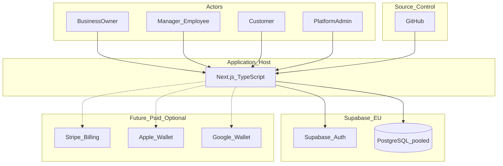
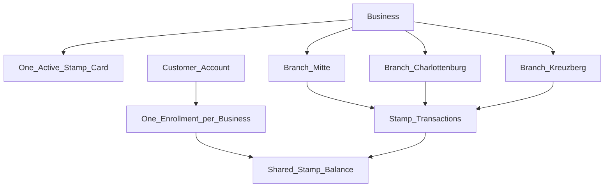

# Smart Loyalty – System Architecture

**Document:** 02_System_Architecture  
**Phase:** 0 (Documentation – refined)  
**Status:** Draft for approval  
**Last updated:** 2026-11-01 (verified integrity pass)

---

## 1. Purpose

Define the multi-tenant SaaS architecture for Smart Loyalty: components, tenancy, API boundaries, auth, idempotent stamp/redeem operations, and free-vs-paid infrastructure posture. Wallet vendor APIs are not invented here; see `06_Wallet_Integration.md`.

---

## 2. Architectural principles

1. **Single Next.js application** (App Router, TypeScript) for MVP — no premature microservices.  
2. **Shared PostgreSQL schema**; tenant key is **`business_id`** (the business row is the tenant).  
3. **Complete business data isolation** via composite foreign keys, server-side authz, and PostgreSQL RLS.  
4. **Supabase Auth** for identity (Email+Password and Email OTP / Magic Link).  
5. **Prisma** for server data access, with **connection pooling** to Supabase.  
6. **Employee-only stamp writes**; customers never grant themselves stamps.  
7. **MVP: one active Stamp Card per business**; all branches share one balance per enrollment.  
8. **Idempotent EARN, REDEEM, ADJUST, REVERSAL** via client-supplied keys + request hash; mismatch → conflict.  
9. **Unified ledger** with distinct `REDEEM` vs `ADJUST` types; employees may redeem, not adjust.  
10. **Redeem math:** subtract required stamps; preserve remainder; one balance update per redemption.  
11. **Wallet adapters**: Simulator (MVP) | Apple | Google — no fake Apple/Google success.  
12. **Free development first**; commercial production may require paid plans — see `10_Free_Infrastructure_and_Costs.md`.  
13. **No paid APIs** without explicit approval.

---

## 3. Context diagram



Hosting note: **Vercel** is a candidate host only where its **current terms** permit the intended usage. See document 10.

---

## 4. Application structure (logical)

```text
Next.js App Router
├── (marketing)        Public landing / pricing (placeholders)
├── (auth)             Login, register, magic link / OTP callbacks
├── join/[slug]        Business QR → mobile-first customer join
├── c/*                Customer account (multi-card Wallet Simulator)
├── dashboard/*        Business SaaS shell (Owner/Manager)
├── staff/*            Mobile staff interface
├── admin/*            Platform administration
└── api/*              Health; Stripe/wallet webhooks later

lib/
├── auth/              Session; requireUser; requireBusinessMember; requirePlatformAdmin
├── db/                Prisma + pooled DATABASE_URL
├── tenants/           Isolation helpers; composite FK-aware queries
├── subscriptions/     Server-side plan / branch limit / status gates
├── qr/                Secure token generate / hash / verify
├── loyalty/           Earn, redeem, adjust with idempotency + row locks
└── wallets/           WalletProvider: Simulator | Apple | Google
```

---

## 5. Multi-tenancy and Stamp Card model

### 5.1 Tenant definition

A **tenant** is one `businesses` row. All business-scoped tables use **`business_id`** as the isolation key.

### 5.2 Isolation requirements

| Layer | Requirement |
|-------|-------------|
| Application | Resolve `business_id` from verified membership; never trust client-supplied ids alone |
| Database | Composite foreign keys prevent cross-business references |
| RLS | Policies deny cross-tenant row access for non-elevated DB roles |
| Analytics | Owner/Manager see own business only; Platform Admin uses elevated path |

### 5.3 MVP Stamp Card rules



- At most one `ACTIVE` program per business (MVP).  
- Shared `stamp_balance` across branches.  
- Reward available when `stamp_balance >= stamps_required`.  
- Redeem subtracts required stamps and keeps remainder; may redeem again if balance still sufficient.

### 5.4 Entity scope

| Entity | Scope |
|--------|--------|
| Auth user / `users` | Global |
| `customers` | Global (one per auth user) |
| `businesses` | Tenant root |
| Branches, members, programs, enrollments, stamps, rewards, wallets, subscriptions | Per `business_id` |
| `subscription_plans` | Global catalog |

---

## 6. API boundaries and responsibilities

| Boundary | Responsibility | Must not |
|----------|----------------|----------|
| Middleware | Session refresh; route gates | Alone authorize stamp/redeem |
| Server Actions / Route Handlers | Authn/authz, rate limits, plan/status gates, idempotency, DB transactions | Trust raw ids without checks |
| Prisma | Persistence; row locks; unique idempotency constraints | Expose DB credentials to browser |
| Supabase Auth | Email+Password, Magic Link / OTP, sessions | Encode tenant business rules |
| Wallet adapter | Simulator updates; later vendor updates | Report fake Apple/Google install success |
| Stripe (future) | Checkout, webhooks | Be required for MVP limit modeling |

### Idempotency contract (required for EARN, REDEEM, ADJUST, REVERSAL)

PostgreSQL-safe concurrency (see `03_Database_Design.md` §7.1.1):

```text
BEGIN
  SELECT enrollment FOR UPDATE
  INSERT INTO stamp_transactions (...)
    ON CONFLICT (business_id, idempotency_key) DO NOTHING
    RETURNING *
  IF inserted:
    apply single balance update (+ reward_redemptions if REDEEM); COMMIT; return applied
  ELSE:
    SELECT existing row by (business_id, idempotency_key)
    IF request_hash matches → return ORIGINAL result (no balance change)
    IF request_hash differs  → CONFLICT (no balance change)
END
```

Never catch-and-retry a second balance mutation after a uniqueness race.

### Stamp write contract (EARN)

```text
Input:  enrollmentId, branchId, stampsDelta (default +1),
        idempotencyKey (required), request_hash (required)
AuthZ:  stamp permission; branch + enrollment scoped to business
Txn:    § idempotency pattern; type EARN; reward_id NULL; reversal_of_transaction_id NULL
Output: replay | conflict | applied
```

### Redeem contract (ledger type REDEEM — not ADJUST)

```text
Input:  enrollmentId, branchId, rewardId, idempotencyKey (required), request_hash (required)
AuthZ:  can_redeem + permitted branch (Employee allowed)
Txn:    BEGIN; lock enrollment FOR UPDATE;
        IF stamp_balance < stamps_required THEN
          ROLLBACK entire transaction;
          // no stamp_transactions REDEEM row
          // no reward_redemptions row
          // no balance change
          // no wallet metadata update
          RETURN INSUFFICIENT_BALANCE
        END IF;
        § idempotency pattern; type REDEEM; reward_id NOT NULL;
        single balance subtract; matching reward_redemptions row; wallet update; COMMIT
Output: replay | conflict | applied | INSUFFICIENT_BALANCE
```

No `ADJUST` row for redemptions. No cancel-completed-redemption in MVP (`reward_redemptions.status` = `COMPLETED` only).

### Manual adjust contract (Owner/Manager only)

```text
Input:  enrollmentId, branchId, stampsDelta, reason (required),
        idempotencyKey (required), request_hash (required)
AuthZ:  OWNER or MANAGER only
Txn:    § idempotency pattern; type ADJUST; reward_id NULL
```

### Reversal contract (Owner/Manager only)

```text
Input:  originalTransactionId, reason (required),
        idempotencyKey (required), request_hash (required)
        amount policy: TBD (Full Reversal only NOT approved)
AuthZ:  OWNER or MANAGER only
Txn:    § idempotency pattern; type REVERSAL; reward_id NULL;
        reversal_of_transaction_id set;
        composite FK enforces same business_id + customer_program_id;
        reject if original already reversed
```

---

## 7. Authentication and session

### Customer (mobile-first)

1. Scan business join QR → `/join/[slug]`.  
2. Create account or log in (Email+Password or Email OTP / Magic Link).  
3. Enroll into the business Stamp Card (idempotent enrollment).  
4. Show digital card (Simulator).  
5. Same account joins other businesses — **no per-business accounts**.

### Business staff

- Same Auth provider; access via `business_members`.  
- Branch defaults: Employees → `SELECTED_BRANCHES`; Owners/Managers → `ALL_BRANCHES` (Owners/Managers may grant an employee `ALL_BRANCHES`).

### Routing

- Platform Admin → `/admin`  
- Owner/Manager → `/dashboard`, `/staff`  
- Employee → `/staff` (no billing routes)  
- Customer → `/join/*`, `/c/*`

---

## 8. Subscription enforcement (architecture)

- Each business has **its own** `subscriptions` row.  
- `effective_max_branches = plan.max_branches + add_on_branches`.  
- Branch create is **server-side gated**.  
- **PAST_DUE:** a **grace period** exists before restricting operations; **exact duration and restriction set are TBD**.  
- Stripe prepared (nullable ids); **MVP does not require live payments**.  
- Plan prices remain **placeholders**.

---

## 9. Archiving posture (architecture)

| Entity | Approach |
|--------|----------|
| Branch | `INACTIVE` / archived status — excluded from new ops; historical txns retained |
| Business | `SUSPENDED` / `CLOSED` — write gates; data retained per retention policy |
| Loyalty program | `ARCHIVED` — MVP keeps one ACTIVE; archive does not delete stamp history |

Details: `03_Database_Design.md`, `07_Security_and_GDPR.md`.

---

## 10. Deployment and tooling posture

| Concern | Development / testing | Commercial production |
|---------|----------------------|------------------------|
| DB + Auth | Supabase Free, EU (Frankfurt if available) | Likely paid when limits/ToS require |
| App host | Candidate: Vercel **if terms allow** | Confirm ToS; upgrade or alternate host |
| Source | GitHub | GitHub |
| Wallets | Simulator only | Apple/Google only with approval |
| Billing | Manual plan flags | Stripe live (future) |

**Prisma** must use the Supabase **pooler** from Phase 1.

---

## 11. Technology decisions

| Decision | Choice | Reasoning |
|----------|--------|-----------|
| Framework | Next.js + TypeScript | One app for all surfaces |
| Data | PostgreSQL on Supabase + Prisma | Auth co-location; transactions; pooling |
| Tenant key | `business_id` only | Removes duplicated columns |
| Integrity | Composite FKs + idempotency uniques | Cross-tenant and duplicate-op safety |
| Wallets | Adapter + Simulator first | Zero paid wallet dependency for MVP |
| Hosting | Vercel candidate + GitHub | Free-dev path; terms rechecked for production |

---

## 12. Risks

- Prisma + free Supabase without pooling.  
- RLS bypass if service-role Prisma skips app authz.  
- Idempotency key lifecycle / client retries.  
- PAST_DUE grace duration undefined until product decides.  
- Concurrent stamps without row locks.  
- Vercel/Supabase free ToS insufficient for commercial launch.

---

## 13. Related documents

- `03_Database_Design.md`  
- `04_User_Roles_and_Permissions.md`  
- `05_User_Flows.md`  
- `06_Wallet_Integration.md`  
- `07_Security_and_GDPR.md`  
- `10_Free_Infrastructure_and_Costs.md`  
