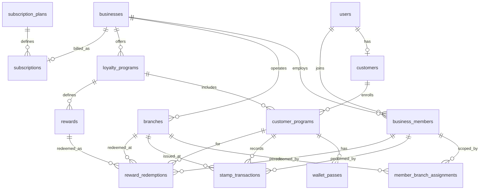

# Smart Loyalty – Database Design

**Document:** 03_Database_Design  
**Phase:** 0 (Documentation – refined)  
**Status:** Draft for approval  
**Last updated:** 2026-11-01 (verified integrity pass)

---

## 1. Purpose

Logical PostgreSQL model for Smart Loyalty (Supabase EU, preferably Frankfurt). Prisma will own migrations in implementation phases — **no migrations in Phase 0**.

---

## 2. Design goals

1. **Complete isolation** of each business’s data.  
2. Every branch belongs to **exactly one** business.  
3. Employees belong to one or more businesses; **selected branches by default**.  
4. Customers: one central account; many business enrollments.  
5. Independent stamp balances per business (shared across that business’s branches).  
6. Composite foreign keys to prevent cross-tenant references.  
7. Secure QR secrets (CSPRNG; hash at rest; no plaintext secret column).  
8. Unified stamp ledger with distinct types: `EARN`, `REDEEM`, `ADJUST`, `REVERSAL` — **ADJUST is never used for reward redemption**.  
9. Concurrency-safe ops with **required idempotency keys** for EARN, REDEEM, ADJUST, and REVERSAL; payload mismatch → conflict.  
10. Redeem subtracts required stamps and preserves remainder; one balance update per redemption; multiple redemptions as separate rows.  
11. Tenant key: **`business_id` only**.  
12. Schema allows multiple loyalty programs later; MVP enforces one ACTIVE program.  
13. Historical transactions retained; soft archive for businesses/branches.

---

## 3. Tenant key

Use only **`business_id UUID NOT NULL`** on business-scoped tables. Terminology: *tenant* = business.

---

## 4. Entity relationship overview



---

## 5. Core entities

### 5.1 `users`

| Column | Type | Notes |
|--------|------|-------|
| id | UUID PK | Align with `auth.users.id` |
| email | CITEXT UNIQUE | |
| full_name | TEXT NULL | |
| role | ENUM | `USER`, `PLATFORM_ADMIN` |
| status | ENUM | `ACTIVE`, `DISABLED` |
| created_at / updated_at | TIMESTAMPTZ | |

### 5.2 `businesses` (tenant root)

| Column | Type | Notes |
|--------|------|-------|
| id | UUID PK | Isolation key |
| name | TEXT | |
| slug | TEXT UNIQUE | `/join/[slug]` |
| industry | TEXT NULL | |
| logo_url | TEXT NULL | |
| brand_theme_json | JSONB NULL | |
| status | ENUM | `ACTIVE`, `SUSPENDED`, `CLOSED` |
| archived_at | TIMESTAMPTZ NULL | Set when CLOSED/archived |
| created_at / updated_at | TIMESTAMPTZ | |

**Archiving:** Prefer status transitions over hard delete. Historical stamps/redemptions remain for retention policy. Closed businesses reject new joins/stamps (application gate).

### 5.3 `business_members`

| Column | Type | Notes |
|--------|------|-------|
| id | UUID PK | |
| business_id | UUID NOT NULL | FK → businesses |
| user_id | UUID NOT NULL | FK → users |
| role | ENUM | `OWNER`, `MANAGER`, `EMPLOYEE` |
| branch_scope | ENUM | `ALL_BRANCHES`, `SELECTED_BRANCHES` |
| can_redeem | BOOLEAN | Default true for roles that redeem |
| status | ENUM | `ACTIVE`, `INVITED`, `DISABLED` |
| created_at / updated_at | TIMESTAMPTZ | |

**Constraints:** UNIQUE `(business_id, user_id)`; UNIQUE `(id, business_id)`; indexes on `(user_id)`, `(business_id)`.

**Confirmed defaults**

| Role | Default `branch_scope` |
|------|------------------------|
| OWNER | `ALL_BRANCHES` |
| MANAGER | `ALL_BRANCHES` |
| EMPLOYEE | `SELECTED_BRANCHES` |

Owners/Managers may set an Employee to `ALL_BRANCHES` when necessary. For `SELECTED_BRANCHES`, rows in `member_branch_assignments` are required before staff ops.

### 5.4 `member_branch_assignments`

| Column | Type | Notes |
|--------|------|-------|
| business_id | UUID NOT NULL | |
| member_id | UUID NOT NULL | |
| branch_id | UUID NOT NULL | |
| created_at | TIMESTAMPTZ | |

- PK `(member_id, branch_id)`  
- FK `(member_id, business_id)` → `business_members (id, business_id)`  
- FK `(branch_id, business_id)` → `branches (id, business_id)`  

### 5.5 `branches`

| Column | Type | Notes |
|--------|------|-------|
| id | UUID PK | |
| business_id | UUID NOT NULL | Exactly one business |
| name | TEXT | |
| address | TEXT NULL | |
| timezone | TEXT | |
| status | ENUM | `ACTIVE`, `INACTIVE` |
| is_add_on | BOOLEAN DEFAULT false | |
| archived_at | TIMESTAMPTZ NULL | When inactivated/archived |
| created_at / updated_at | TIMESTAMPTZ | |

**Constraints:** UNIQUE `(business_id, name)`; UNIQUE `(id, business_id)`.

**Archiving:** `INACTIVE` branches cannot be selected for new earn/redeem; past transactions that reference them are retained indefinitely under the retention policy (no cascade delete).

**Subscription counting:** Only `ACTIVE` branches count toward `effective_max_branches` (confirmed product intent for capacity; reactivation still subject to limit checks).

### 5.6 `loyalty_programs` (Stamp Card)

| Column | Type | Notes |
|--------|------|-------|
| id | UUID PK | |
| business_id | UUID NOT NULL | |
| name | TEXT | |
| description | TEXT NULL | |
| stamps_required | INT NOT NULL CHECK (> 0) | Stamps subtracted per redemption |
| status | ENUM | `ACTIVE`, `ARCHIVED` |
| card_theme_json | JSONB | |
| created_at / updated_at | TIMESTAMPTZ | |

**Constraints:** UNIQUE `(id, business_id)`; partial UNIQUE one `ACTIVE` per `business_id` (MVP).

### 5.7 `customers`

| Column | Type | Notes |
|--------|------|-------|
| id | UUID PK | |
| user_id | UUID UNIQUE NOT NULL | |
| email | CITEXT | |
| full_name | TEXT NULL | |
| phone | TEXT NULL | |
| status | ENUM | `ACTIVE`, `DISABLED` |
| created_at / updated_at | TIMESTAMPTZ | |

### 5.8 `customer_programs` (enrollment + shared balance)

| Column | Type | Notes |
|--------|------|-------|
| id | UUID PK | |
| business_id | UUID NOT NULL | |
| customer_id | UUID NOT NULL | |
| loyalty_program_id | UUID NOT NULL | |
| stamp_balance | INT NOT NULL DEFAULT 0 CHECK (>= 0) | Shared across branches |
| lifetime_stamps | INT NOT NULL DEFAULT 0 | |
| qr_token_hash | BYTEA NOT NULL | Lookup hash |
| qr_token_ciphertext | BYTEA NULL | AEAD for re-display |
| qr_last_rotated_at | TIMESTAMPTZ NULL | |
| status | ENUM | `ACTIVE`, `PAUSED` |
| joined_at | TIMESTAMPTZ | |
| updated_at | TIMESTAMPTZ | |
| version | INT NOT NULL DEFAULT 0 | Optional optimistic aid |

**Constraints:** UNIQUE `(customer_id, loyalty_program_id)`; UNIQUE `(customer_id, business_id)`; UNIQUE `(qr_token_hash)`; UNIQUE `(id, business_id)`; FK `(loyalty_program_id, business_id)` → `loyalty_programs (id, business_id)`.

**Reward availability (derived):** `stamp_balance >= loyalty_programs.stamps_required` (and ACTIVE reward exists).

### 5.9 `wallet_passes`

| Column | Type | Notes |
|--------|------|-------|
| id | UUID PK | |
| business_id | UUID NOT NULL | |
| customer_program_id | UUID NOT NULL | |
| platform | ENUM | `SIMULATOR`, `APPLE`, `GOOGLE` |
| serial_number | TEXT NOT NULL | |
| external_pass_id | TEXT NULL | |
| status | ENUM | `ACTIVE`, `EXPIRED`, `REVOKED`, `PENDING` |
| last_synced_at | TIMESTAMPTZ NULL | |
| metadata_json | JSONB | Balance, rewardAvailable, branding refs — no QR secrets |
| created_at / updated_at | TIMESTAMPTZ | |

UNIQUE `(platform, serial_number)`; UNIQUE `(customer_program_id, platform)`; FK `(customer_program_id, business_id)` → `customer_programs (id, business_id)`.

### 5.10 `stamp_transactions` (unified ledger)

| Column | Type | Notes |
|--------|------|-------|
| id | UUID PK | |
| business_id | UUID NOT NULL | |
| customer_program_id | UUID NOT NULL | |
| branch_id | UUID NOT NULL | Branch where operation occurred |
| performed_by_member_id | UUID NOT NULL | Responsible member |
| type | ENUM | `EARN`, `REDEEM`, `ADJUST`, `REVERSAL` |
| stamps_delta | INT NOT NULL | Sign by type (see CHECKs) |
| balance_after | INT NOT NULL | Must be ≥ 0 |
| reason | TEXT NULL | **Required when type ∈ {ADJUST, REVERSAL}**; NULL for EARN/REDEEM |
| reward_id | UUID NULL | **NOT NULL iff type = REDEEM**; NULL for EARN/ADJUST/REVERSAL |
| reversal_of_transaction_id | UUID NULL | **NOT NULL iff type = REVERSAL**; points at original ledger row |
| idempotency_key | TEXT NOT NULL | Required for **all** types |
| request_hash | TEXT NOT NULL | Hash of canonical request payload for conflict detection |
| created_at | TIMESTAMPTZ NOT NULL | Append-oriented |

**Type semantics (normative)**

| Type | Who | Purpose | Balance effect |
|------|-----|---------|----------------|
| `EARN` | Owner, Manager, Employee | Issue stamps | `stamps_delta > 0`; `reward_id` NULL |
| `REDEEM` | Owner, Manager, Employee (`can_redeem`) | Reward redemption ledger line | `stamps_delta < 0`; `reward_id` **required** |
| `ADJUST` | **Owner, Manager only** | Manual correction | nonzero delta; reason required; `reward_id` NULL |
| `REVERSAL` | **Owner, Manager only** | Reverse a prior mistake | nonzero delta; reason required; `reversal_of_transaction_id` **required** |

**Employees may create `REDEEM` rows. Employees must never create `ADJUST` or `REVERSAL` rows.** Redemption must not be modeled as `ADJUST`.

**REVERSAL rules**

- Column **`reversal_of_transaction_id`** is defined on `stamp_transactions` (see column table above).  
- Same **business** and same **enrollment** are enforced with a composite FK (below), not only application checks.  
- **UNIQUE `(reversal_of_transaction_id)` WHERE type = 'REVERSAL'** (partial unique) — the same original transaction cannot be reversed more than once.  
- Full vs partial reversal amount: **explicitly TBD** (Full Reversal only has **not** been approved). Do not invent UX.  
- Reversing a `REDEEM` / undoing a completed redemption is tied to cancellation policy (**TBD** / **blocked in MVP** — see §5.12).

**Constraints / FKs**

- UNIQUE `(id, business_id)`  
- UNIQUE `(id, business_id, type)` — typed FK target for `reward_redemptions`  
- UNIQUE `(id, business_id, customer_program_id)` — enrollment-scoped FK target for reversals  
- FK `(customer_program_id, business_id)` → `customer_programs (id, business_id)`  
- FK `(branch_id, business_id)` → `branches (id, business_id)`  
- FK `(performed_by_member_id, business_id)` → `business_members (id, business_id)`  
- FK `(reward_id, business_id)` → `rewards (id, business_id)` when `reward_id` is not null  
- **Same-business + same-enrollment reversal FK:**  
  `(reversal_of_transaction_id, business_id, customer_program_id)`  
  → `stamp_transactions (id, business_id, customer_program_id)`  
  when `reversal_of_transaction_id` is not null  
- **UNIQUE `(business_id, idempotency_key)`** — one ledger outcome per key per business  
- Partial UNIQUE `(reversal_of_transaction_id)` WHERE `type = 'REVERSAL'`  
- CHECK `balance_after >= 0`  
- CHECK `reward_id` / `reversal_of_transaction_id` by type (normative):

```sql
CHECK (
  (type = 'EARN'     AND stamps_delta > 0  AND reward_id IS NULL     AND reversal_of_transaction_id IS NULL)
  OR (type = 'REDEEM'   AND stamps_delta < 0  AND reward_id IS NOT NULL AND reversal_of_transaction_id IS NULL)
  OR (type = 'ADJUST'   AND stamps_delta <> 0 AND reward_id IS NULL     AND reversal_of_transaction_id IS NULL)
  OR (type = 'REVERSAL' AND stamps_delta <> 0 AND reward_id IS NULL     AND reversal_of_transaction_id IS NOT NULL)
)
```

- CHECK reason required for ADJUST/REVERSAL only:

```sql
CHECK (
  (type IN ('ADJUST','REVERSAL') AND reason IS NOT NULL AND length(trim(reason)) > 0)
  OR (type IN ('EARN','REDEEM') AND reason IS NULL)
)
```

**Indexes:** `(business_id, created_at DESC)`, `(customer_program_id, created_at DESC)`, `(branch_id, created_at DESC)`, `(performed_by_member_id, created_at DESC)`, `(type, created_at DESC)`, `(reversal_of_transaction_id)`.

**Retention:** Do not hard-delete stamp history for normal operations; see `07_Security_and_GDPR.md`.

### 5.11 `rewards`

| Column | Type | Notes |
|--------|------|-------|
| id | UUID PK | |
| business_id | UUID NOT NULL | |
| loyalty_program_id | UUID NOT NULL | |
| name | TEXT | |
| stamps_required | INT NOT NULL CHECK (> 0) | Stamps to subtract on redeem (typically matches program) |
| description | TEXT NULL | |
| status | ENUM | `ACTIVE`, `ARCHIVED` |
| created_at / updated_at | TIMESTAMPTZ | |

UNIQUE `(id, business_id)`; FK `(loyalty_program_id, business_id)` → `loyalty_programs (id, business_id)`.

### 5.12 `reward_redemptions`

Domain detail for a completed reward claim. Balance is changed **once** via the linked `stamp_transactions` row of type `REDEEM` — not a second time here.

| Column | Type | Notes |
|--------|------|-------|
| id | UUID PK | |
| business_id | UUID NOT NULL | |
| reward_id | UUID NOT NULL | |
| customer_program_id | UUID NOT NULL | |
| branch_id | UUID NOT NULL | Branch where redeemed |
| redeemed_by_member_id | UUID NOT NULL | |
| stamps_subtracted | INT NOT NULL | Amount subtracted; must be > 0 |
| balance_after | INT NOT NULL | Must match linked ledger `balance_after` |
| stamp_transaction_id | UUID NOT NULL | Links to the corresponding ledger `REDEEM` row |
| stamp_transaction_type | ENUM NOT NULL DEFAULT `REDEEM` | Fixed to `REDEEM` for typed FK |
| idempotency_key | TEXT NOT NULL | Same key as the linked ledger row |
| request_hash | TEXT NOT NULL | Same hash as the linked ledger row |
| status | ENUM | **`COMPLETED` only for MVP** (`CANCELLED` is not part of the MVP schema) |
| created_at | TIMESTAMPTZ | |

**Constraints / FKs**

- FK `(reward_id, business_id)` → `rewards (id, business_id)`  
- FK `(customer_program_id, business_id)` → `customer_programs (id, business_id)`  
- FK `(branch_id, business_id)` → `branches (id, business_id)`  
- FK `(redeemed_by_member_id, business_id)` → `business_members (id, business_id)`  
- **Composite typed FK (retained):**  
  `(stamp_transaction_id, business_id, stamp_transaction_type)`  
  → `stamp_transactions (id, business_id, type)`  
  with CHECK `stamp_transaction_type = 'REDEEM'`  
  so a redemption can **only** reference its corresponding `REDEEM` ledger transaction (never `ADJUST` / `EARN` / `REVERSAL`).  
- UNIQUE `(stamp_transaction_id)` — one redemption detail row per ledger REDEEM  
- UNIQUE `(business_id, idempotency_key)` — aligns with ledger uniqueness  
- CHECK `stamps_subtracted > 0`  
- CHECK `balance_after >= 0`  

**Cross-row integrity (REDEEM ledger ↔ `reward_redemptions`)**

Within the same DB transaction that creates both rows, and verified by **mandatory integration tests**, these fields **must match**:

| Field | Match rule |
|-------|------------|
| `business_id` | Equal |
| `customer_program_id` | Equal |
| `branch_id` | Equal to ledger `branch_id` |
| Employee | `redeemed_by_member_id` = ledger `performed_by_member_id` |
| `reward_id` | Equal to ledger `reward_id` (ledger `reward_id` NOT NULL) |
| Amount | `stamps_subtracted` = `abs(ledger.stamps_delta)` |
| `balance_after` | Equal |
| `idempotency_key` | Equal |
| `request_hash` | Equal |

Enforce via: single transactional write path + integration tests. Prefer DB triggers or DEFERRABLE constraints where practical; application must not ship a path that writes mismatched pairs.

Each successful redemption creates **exactly one** `stamp_transactions` (`REDEEM`) and **exactly one** `reward_redemptions` row, with a **single** enrollment balance update. Customers may redeem multiple times if balance allows; each attempt needs a distinct idempotency key.

**Cancellation of completed redemptions — TBD / blocked in MVP**

- Product policy for cancelling a completed redemption is **TBD**.  
- **MVP schema:** `reward_redemptions.status` admits **`COMPLETED` only** — do not include `CANCELLED` in the MVP enum.  
- **MVP product:** no cancel-redemption UI or API; no ambiguous balance restores.  
- If cancellation is approved later, add status values and compensating ledger rules in a later phase (must keep ledger + balance consistent).

### 5.13 `subscription_plans`

| Column | Type | Notes |
|--------|------|-------|
| id | UUID PK | |
| code | TEXT UNIQUE | `starter`, `professional`, `business`, `enterprise` |
| name | TEXT | |
| tier | ENUM | |
| price_monthly_cents | INT | **Placeholder** display only |
| max_branches | INT NOT NULL | |
| max_employees | INT NOT NULL | |
| max_active_programs | INT NOT NULL | MVP product uses 1 |
| max_customers | INT NULL | |
| features_json | JSONB | |
| is_active | BOOLEAN | |
| created_at / updated_at | TIMESTAMPTZ | |

Commercial pricing is **not finalized** in Phase 0.

### 5.14 `subscriptions`

| Column | Type | Notes |
|--------|------|-------|
| id | UUID PK | |
| business_id | UUID UNIQUE NOT NULL | |
| plan_id | UUID NOT NULL | |
| status | ENUM | `TRIALING`, `ACTIVE`, `PAST_DUE`, `CANCELLED`, `EXPIRED` |
| current_period_start / end | TIMESTAMPTZ NULL | |
| past_due_since | TIMESTAMPTZ NULL | When entered PAST_DUE |
| grace_period_ends_at | TIMESTAMPTZ NULL | End of grace; **duration TBD** at product level |
| add_on_branches | INT NOT NULL DEFAULT 0 | |
| stripe_customer_id | TEXT NULL | Future |
| stripe_subscription_id | TEXT NULL | Future |
| created_at / updated_at | TIMESTAMPTZ | |

**Effective branch limit** = `plan.max_branches + add_on_branches`.

**PAST_DUE:** Grace period is a confirmed concept. Exact duration and which operations are restricted after grace remain **TBD** (do not invent values).

---

## 6. Composite foreign keys

```text
parent:  UNIQUE (id, business_id)
child:   FOREIGN KEY (parent_id, business_id) REFERENCES parent (id, business_id)

-- Typed link: redemption → REDEEM ledger only
stamp_transactions: UNIQUE (id, business_id, type)
reward_redemptions: FOREIGN KEY (stamp_transaction_id, business_id, stamp_transaction_type)
                    REFERENCES stamp_transactions (id, business_id, type)
                    with stamp_transaction_type CHECK (= 'REDEEM')

-- Reversal → original same business + same enrollment
stamp_transactions: UNIQUE (id, business_id, customer_program_id)
REVERSAL row: FOREIGN KEY (reversal_of_transaction_id, business_id, customer_program_id)
              REFERENCES stamp_transactions (id, business_id, customer_program_id)
```

Prevents cross-business mixes, non-`REDEEM` redemption links, and cross-enrollment reversals.

---

## 7. Stamp concurrency, redeem math, and idempotency

### 7.1 Idempotency rules (all mutating loyalty ops)

**Required** for: `EARN`, `REDEEM`, `ADJUST`, `REVERSAL`.

| Step | Behavior |
|------|----------|
| Scope | UNIQUE `(business_id, idempotency_key)` on `stamp_transactions` (ledger is source of truth) |
| Payload | Store `request_hash` of the canonical request (operation type, enrollment, branch, delta/reward, actor intent fields) |
| Same key + **same** `request_hash` | Return original successful result; **no** new ledger/redemption rows; **no** second balance change |
| Same key + **different** `request_hash` | **Conflict** (not success); do not apply side effects |
| Same key for a different operation or customer/enrollment | Treated as payload mismatch → **Conflict**; never return another operation’s or customer’s prior result as success |

`reward_redemptions` stores the same `idempotency_key` / `request_hash` as its linked `REDEEM` ledger row for traceability; uniqueness on the ledger prevents double application.

### 7.1.1 Concurrent requests with the same idempotency key (PostgreSQL-safe)

Do **not** rely on catching unique-violation exceptions as the primary control path. Use this PostgreSQL-safe pattern for **EARN, REDEEM, ADJUST, and REVERSAL**:

```text
BEGIN;
  -- 1) Lock enrollment before mutating balance
  SELECT ... FROM customer_programs WHERE id = $enrollment_id FOR UPDATE;

  -- 2) Attempt ledger insert; conflict on UNIQUE (business_id, idempotency_key)
  INSERT INTO stamp_transactions (..., business_id, idempotency_key, request_hash, ...)
  VALUES (...)
  ON CONFLICT (business_id, idempotency_key) DO NOTHING
  RETURNING *;

  -- 3a) If INSERT returned a row: this request won.
  --     For REDEEM: balance was already verified ≥ need before insert (see §7.3).
  --       If that check was skipped and balance is now insufficient: ROLLBACK entire txn
  --       (no REDEEM row, no reward_redemptions, no balance/wallet change) → INSUFFICIENT_BALANCE.
  --     Otherwise apply the single balance update (and reward_redemptions if REDEEM).
  --     COMMIT; return applied result.

  -- 3b) If INSERT returned no row: a concurrent/prior writer owns this key.
  --     Do NOT apply any balance change.
  SELECT * FROM stamp_transactions
   WHERE business_id = $business_id AND idempotency_key = $key;

  --     Compare request_hash:
  --       match    → return ORIGINAL result (load reward_redemptions if type = REDEEM)
  --       differ   → return CONFLICT
COMMIT; -- or ROLLBACK after CONFLICT with no mutations
```

Rules:

- Matching hash → original success; **never** a second balance change.  
- Different hash → **CONFLICT**; **never** a second balance change.  
- Integration tests: parallel identical keys (replay), parallel same key different hash (conflict), balance changes exactly once on success.

### 7.2 Earn

1. AuthZ (member, branch permission, enrollment match, status gates).  
2. **Required** `idempotency_key` + `request_hash`.  
3. Follow §7.1.1: `FOR UPDATE` enrollment → `INSERT … ON CONFLICT DO NOTHING` for `EARN` (`reward_id` NULL).  
4. If insert won: update `stamp_balance` / `lifetime_stamps` once; update Simulator; commit.  
5. If conflict row exists: compare `request_hash` → replay or CONFLICT; **no** balance change.

### 7.3 Redeem (confirmed math; separate from ADJUST)

Example: balance 12, reward requires 10 → balance becomes **2**. Remaining stamps are preserved.

1. AuthZ (`can_redeem`, branch permission) — Employees allowed; not an ADJUST path.  
2. **Required** `idempotency_key` + `request_hash`.  
3. `BEGIN`; `SELECT` enrollment `FOR UPDATE`.  
4. Let `need = reward.stamps_required` (`need > 0`).  
5. **Insufficient balance (normative):** if `stamp_balance < need`:  
   - **ROLL BACK** the entire database transaction (or abort before any writes).  
   - Do **not** leave a `stamp_transactions` `REDEEM` row.  
   - Do **not** leave a `reward_redemptions` row.  
   - Do **not** modify the customer balance.  
   - Do **not** update wallet metadata.  
   - Do **not** persist an idempotency outcome for this failed attempt.  
   - Return **`INSUFFICIENT_BALANCE`**.  
6. Otherwise follow §7.1.1 with `type = REDEEM`, `reward_id` **NOT NULL**.  
7. If insert won: single balance update (`stamp_balance := stamp_balance - need`); insert matching `reward_redemptions`; wallet update; `COMMIT`.  
8. If conflict row exists: compare `request_hash` → replay original (incl. redemption detail) or CONFLICT; **no** second balance change.  
9. If any step after a provisional write fails validation, **ROLL BACK** the whole transaction so no orphan ledger/redemption rows remain.  
10. Do **not** insert an `ADJUST` row for redemptions.

### 7.4 Manual adjust (Owner/Manager only)

1. Require OWNER or MANAGER; `reason` non-empty. Employees denied.  
2. **Required** `idempotency_key` + `request_hash`.  
3. §7.1.1 with `type = ADJUST`, `reward_id` NULL, `reversal_of_transaction_id` NULL.  
4. Balance update only if insert won.

### 7.5 Reversal (Owner/Manager only)

1. Require OWNER or MANAGER; `reason` non-empty.  
2. **Required** `idempotency_key` + `request_hash`.  
3. Target original must satisfy composite FK same `business_id` + `customer_program_id`.  
4. Reject if original already reversed (partial unique on `reversal_of_transaction_id`).  
5. Full vs partial amount: **TBD** (not approved).  
6. §7.1.1 with `type = REVERSAL`, `reward_id` NULL, `reversal_of_transaction_id` set; balance update only if insert won; no `reward_redemptions` row.  
7. Do not silently edit the original row.

### 7.6 Isolation level

Read Committed + `FOR UPDATE` on the enrollment row; idempotency uniqueness as the cross-request safety net.

---

## 8. Indexing summary

| Concern | Approach |
|---------|----------|
| Join URL | UNIQUE `businesses.slug` |
| Membership | UNIQUE `(business_id, user_id)` |
| Enrollment | UNIQUE `(customer_id, business_id)` |
| QR lookup | UNIQUE `qr_token_hash` |
| One active program | Partial UNIQUE ACTIVE per business |
| Idempotent ledger | UNIQUE `(business_id, idempotency_key)` on `stamp_transactions` |
| Redemption ↔ REDEEM | Typed composite FK + UNIQUE `stamp_transaction_id` |
| Single reversal | Partial UNIQUE `reversal_of_transaction_id` where type = REVERSAL |
| Audit | Time indexes by business, branch, member, enrollment, type |

---

## 9. Future-proofing

| Feature | Hook |
|---------|------|
| Multiple active programs | Relax partial unique |
| Geofencing / marketing | Side tables keyed by `business_id` |
| Real wallets | `wallet_passes.platform` |
| Async wallet push | Optional outbox later |

---

## 10. Related documents

- `02_System_Architecture.md`  
- `04_User_Roles_and_Permissions.md`  
- `05_User_Flows.md`  
- `06_Wallet_Integration.md`  
- `07_Security_and_GDPR.md`  
- `08_Subscription_and_Pricing.md`  
