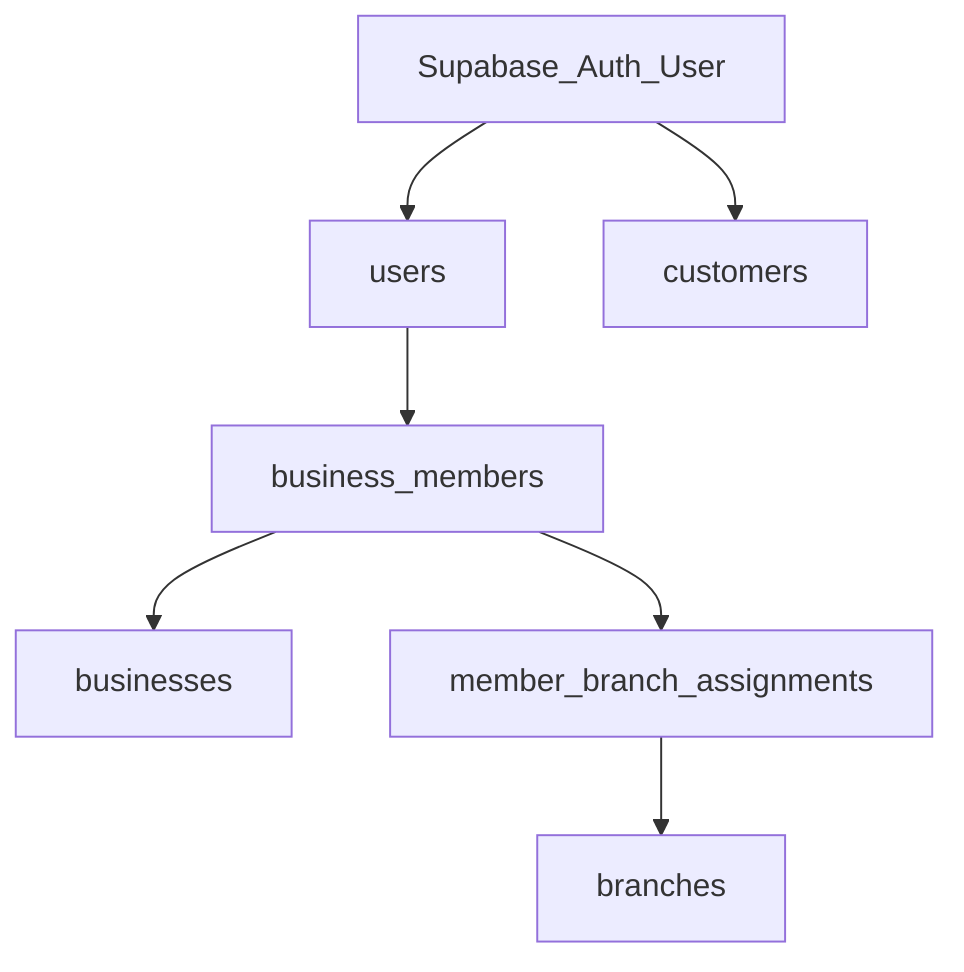

# Smart Loyalty – User Roles and Permissions

**Document:** 04_User_Roles_and_Permissions  
**Phase:** 0 (Documentation – refined)  
**Status:** Draft for approval  
**Last updated:** 2026-11-01 (verified integrity pass)

---

## 1. Purpose

Define identities, roles, branch assignment, and authorization. Stamp issuance and redemption are staff-only; manual adjustments are Owner/Manager only.

---

## 2. Identity model

- One Auth user → optional `customers` + zero or more `business_members`.  
- Same person may be customer of Business A and employee of Business B.  
- **No separate customer account per business.**  
- Auth: Email+Password or Email OTP / Magic Link.

---

## 3. Role catalog

### 3.1 Platform (`users.role`)

| Role | Description |
|------|-------------|
| `USER` | Default |
| `PLATFORM_ADMIN` | Platform operations |

### 3.2 Business (`business_members.role`)

| Role | Description |
|------|-------------|
| `OWNER` | Full control including **subscription and billing** |
| `MANAGER` | Operations without billing; may adjust stamps |
| `EMPLOYEE` | Scan, stamp, redeem if authorized; **no billing**; **no manual adjustments** |

### 3.3 Customer

Via `customers` + `customer_programs`. Cannot stamp, redeem as staff, or adjust balances.

---

## 4. Branch assignment (confirmed)

| `branch_scope` | Meaning |
|----------------|---------|
| `ALL_BRANCHES` | Any ACTIVE branch of the membership’s business |
| `SELECTED_BRANCHES` | Only branches in `member_branch_assignments` |

| Role | Default | Notes |
|------|---------|-------|
| OWNER | `ALL_BRANCHES` | — |
| MANAGER | `ALL_BRANCHES` | — |
| EMPLOYEE | `SELECTED_BRANCHES` | Owner/Manager may grant `ALL_BRANCHES` when necessary |

Staff must select a **permitted** branch before stamp/redeem/adjust; that branch is stored on the audit row. Employees must not access other businesses’ customers.

---

## 5. Permission matrix

Legend: **Y** allowed, **N** denied, **P** partial (minimized fields).

### 5.1 Platform

| Action | Platform Admin | Owner | Manager | Employee | Customer |
|--------|----------------|-------|---------|----------|----------|
| List / suspend tenants | Y | N | N | N | N |
| Manage plan catalog | Y | N | N | N | N |
| View platform stats | Y | N | N | N | N |

### 5.2 Business configuration

| Action | Owner | Manager | Employee | Customer |
|--------|-------|---------|----------|----------|
| Update business settings / branding | Y | Y | N | N |
| Manage subscription / add-on branches / billing | **Y** | **N** | **N** | N |
| Configure Stamp Card | Y | Y | N | N |
| Manage rewards definition | Y | Y | N | N |
| CRUD branches (subject to plan limits) | Y | Y | N | N |
| Archive / inactivate branches | Y | Y | N | N |
| Invite / disable members; set `branch_scope` | Y | Y | N | N |
| Grant employee `ALL_BRANCHES` | Y | Y | N | N |
| View customers & balances (tenant only) | Y | Y | P | N |
| View analytics | Y | Y | N | N |

### 5.3 Staff operations

| Action | Owner | Manager | Employee | Customer |
|--------|-------|---------|----------|----------|
| Access `/staff` | Y | Y | Y | N |
| Select permitted branch | Y | Y | Y | N |
| Scan customer QR (own business only) | Y | Y | Y | N |
| Issue stamp (`EARN`) with idempotency key | Y | Y | Y | N |
| Redeem reward → ledger type `REDEEM` (not ADJUST); idempotency required | Y | Y | Y | N |
| Manual `ADJUST` with reason + idempotency required | **Y** | **Y** | **N** | N |
| `REVERSAL` with idempotency; `reversal_of_transaction_id`; once | **Y** | **Y** | **N** | N |
| Cancel completed redemption | **N (MVP)** | **N (MVP)** | **N** | N |
| View full customer email/phone | Y | Y | **N** | N |
| Access other businesses’ customers | N | N | N | N |

**Employee minimized view:** display name, stamp balance, reward availability, limited recent history for **this business** — not email/phone.

Every EARN, REDEEM, ADJUST, and REVERSAL stores responsible member + branch on the stamp ledger. Adjustments/reversals also store **reason**. Employee redemptions create `REDEEM` ledger rows only — they must never create `ADJUST`/`REVERSAL` rows.

### 5.4 Customer

| Action | Customer |
|--------|----------|
| Register / login (password or magic link / OTP) | Y |
| Join business via QR / slug | Y |
| View own cards across businesses | Y |
| Show card QR for staff | Y |
| Self-issue stamps / self-redeem as staff / self-adjust | **N** |

---

## 6. Authorization rules (normative)

1. Resolve actor from session → `users.id`.  
2. Load ACTIVE `business_members` for `(user_id, business_id)`.  
3. For stamp/redeem/adjust: verify role; branch ∈ business; branch permitted by scope; enrollment `business_id` matches.  
4. `ADJUST` / `REVERSAL` only if role ∈ {OWNER, MANAGER} and `reason` present.  
5. `REVERSAL` must reference an original txn in the same business and enrollment; cannot reverse the same original twice.  
6. `REDEEM` is a separate permission path (`can_redeem`); never implemented as ADJUST; ledger `reward_id` required; insufficient balance returns `INSUFFICIENT_BALANCE` with full rollback and no ledger/redemption/balance/wallet side effects.  
7. Never authorize from client-supplied `businessId` alone.  
8. Billing routes: Owner only.  
9. Idempotency keys **required** for EARN, REDEEM, ADJUST, and REVERSAL; concurrent path uses `INSERT … ON CONFLICT DO NOTHING` then compare `request_hash` (never second balance change).  
10. Cancel completed redemption: **not in MVP** (policy **TBD**); no `CANCELLED` status in MVP schema.  
11. Reversal amount full vs partial: **TBD** (Full Reversal only has **not** been approved).

---

## 7. Invitation lifecycle

| State | Meaning |
|-------|---------|
| `INVITED` | Cannot stamp until accepted |
| `ACTIVE` | Permissions apply |
| `DISABLED` | No staff/dashboard access for that business; history retained |

At least one ACTIVE OWNER should remain per business (transfer rules **TBD**).

---

## 8. Unresolved permission decisions

1. Whether Managers get read-only subscription **usage** meters (still **no** purchase).  
2. Owner transfer / last-owner protection rules.  
3. Platform Admin impersonation — discouraged; prefer audited support tools.  
4. Full vs partial REVERSAL amounts (**TBD** — Full Reversal only not approved).  
5. Who may cancel a completed redemption after MVP policy is defined (**TBD**).

---

## 9. Related documents

- `02_System_Architecture.md`  
- `03_Database_Design.md`  
- `05_User_Flows.md`  
- `07_Security_and_GDPR.md`  
