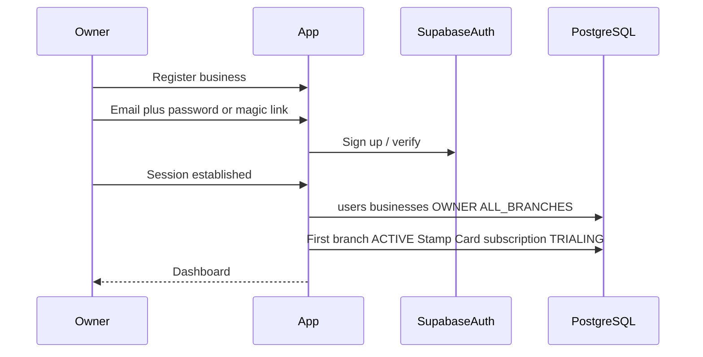
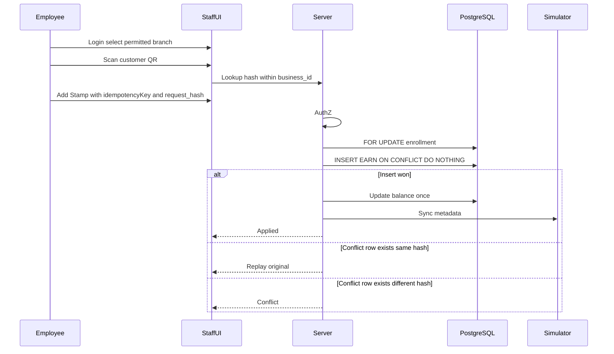

# Smart Loyalty – User Flows

**Document:** 05_User_Flows  
**Phase:** 0 (Documentation – refined)  
**Status:** Draft for approval  
**Last updated:** 2026-11-01 (verified integrity pass)

---

## 1. Purpose

End-to-end flows for business onboarding, mobile-first customer registration, multi-business join, global branch loyalty, staff stamp/redeem with idempotency (**EARN, REDEEM, ADJUST, REVERSAL**), and subscription limits.

---

## 2. Business registration and first setup

**Outcomes:** Business slug; first branch; one ACTIVE Stamp Card; per-business subscription; join QR → `/join/{slug}`.

---

## 3. Customer registration (mobile-first)

1. Customer scans the business QR code.  
2. Website opens `/join/[slug]`.  
3. First visit: create a **central** account.  
4. Auth: **Email + Password** or **Email OTP / Magic Link**.  
5. Existing customers log in.  
6. Enroll in the business Stamp Card (idempotent enrollment).  
7. Digital card appears (Wallet Simulator).  
8. Same account joins other businesses later.

No stamps on join. Apple/Google install is not success-simulated.

---

## 4. Multi-business customer account

One Auth identity; independent balances per business enrollment.

---

## 5. Global branch loyalty

| Rule | Behavior |
|------|----------|
| Enrollment | One Stamp Card enrollment per business |
| Balance | Single shared `stamp_balance` |
| Earn | Any permitted branch; ledger `EARN` |
| Redeem | Ledger `REDEEM` + `reward_redemptions`; subtract required; preserve remainder |
| Multiple rewards | Allowed when balance still sufficient; each redemption separate |
| Staff | Own business; permitted branches only |

---

## 6. Idempotency (required for EARN, REDEEM, ADJUST, REVERSAL)

Every mutating loyalty operation **must** send `idempotency_key` + `request_hash`.

PostgreSQL-safe concurrency (authoritative detail in `03_Database_Design.md` §7.1.1):

1. `SELECT` enrollment `FOR UPDATE`.  
2. `INSERT … ON CONFLICT (business_id, idempotency_key) DO NOTHING RETURNING *`.  
3. If a row was inserted → apply **one** balance update (and redemption detail if REDEEM).  
4. If no row returned → `SELECT` existing ledger by key → compare `request_hash` → **replay** (match) or **CONFLICT** (differ).  
5. Never apply a second balance change on the conflict path.

| Outcome | Condition |
|---------|-----------|
| Apply | Insert won |
| Replay | Same key + same `request_hash` |
| Conflict | Same key + different `request_hash` |

---

## 7. Employee stamp flow (EARN)

- `idempotency_key` and `request_hash` **required** (same as REDEEM / ADJUST / REVERSAL).  
- Employees use `SELECTED_BRANCHES` by default (unless granted `ALL_BRANCHES`).  
- Ledger row: `type = EARN`, `reward_id` NULL, `reversal_of_transaction_id` NULL.

---

## 8. Reward flow (ledger type REDEEM)

1. When `stamp_balance >= stamps_required`, reward is **available** on the card UI.  
2. Authorized staff (including Employees with `can_redeem`) redeems with a **new idempotency key** + `request_hash`.  
3. Server locks enrollment.  
4. **If balance is less than required stamps:** roll back the **entire** DB transaction and return **`INSUFFICIENT_BALANCE`**. Effects must be none:  
   - no `stamp_transactions` `REDEEM` row  
   - no `reward_redemptions` row  
   - no customer balance change  
   - no wallet metadata update  
5. **If balance is sufficient:** balance becomes `stamp_balance - stamps_required` (e.g. 12 → 2) — **one** balance update; insert matching `REDEEM` ledger + `reward_redemptions`; update wallet; commit.  
6. Do **not** write an `ADJUST` row.  
7. Further successful redemptions need new keys if remainder still qualifies.  
8. Idempotency: replay / conflict / `ON CONFLICT` handling as in §6 (only for attempts that proceed past the balance check, or replay a prior **successful** redeem).  
9. **MVP:** no cancel-completed-redemption action (cancellation policy **TBD**).

---

## 9. Manual ADJUST flow (Owner/Manager only)

1. Owner or Manager only (Employees **cannot**).  
2. Select permitted branch and enrollment.  
3. Enter delta and **required reason**; idempotency key **required**.  
4. Insert `ADJUST` (`reward_id` NULL); single balance update.  
5. Replay / conflict / race rules as in §6.

---

## 10. REVERSAL flow (Owner/Manager only)

1. Owner or Manager only.  
2. Select original ledger transaction; require same business and same customer enrollment.  
3. Reject if that original was already reversed (`reversal_of_transaction_id` unique).  
4. Full vs partial reversal amount: **explicitly TBD** (Full Reversal only has **not** been approved).  
5. `idempotency_key` + `request_hash` **required**; `INSERT … ON CONFLICT DO NOTHING` pattern; `reversal_of_transaction_id` set; composite FK same business + enrollment; balance update only if insert won; no `reward_redemptions` row.  
6. Do not silently edit the original row.  
7. Reversing a `REDEEM` / undoing a completed redemption remains **TBD** and is **not** exposed in MVP (`reward_redemptions.status` = `COMPLETED` only).

---

## 11. Branch and subscription flows

1. Owner/Manager opens Branches.  
2. Create branch only if ACTIVE count < effective max (**server-side**).  
3. New branches share the same Stamp Card.  
4. Inactivate/archive branch: no new ops; history retained.  
5. Employees cannot open billing.  
6. **PAST_DUE:** grace period before restrictions; **duration and exact restriction set TBD**.

---

## 12. Subscription change (Owner)

Owner views usage vs placeholder plan limits; upgrade/add-on via Stripe later. Managers/Employees: no billing access.

---

## 13. Platform admin

List tenants, suspend/close, plan catalog (placeholder prices), platform stats.

---

## 14. Error and edge cases

| Case | Behavior |
|------|----------|
| Same idempotency key + same payload | Replay original; no second txn / balance change |
| Same idempotency key + different payload | Conflict |
| Concurrent same key | `ON CONFLICT DO NOTHING` → SELECT + compare hash → replay or CONFLICT; never double-apply |
| Insufficient balance on redeem | **`INSUFFICIENT_BALANCE`**; full txn rollback; no REDEEM row, no `reward_redemptions`, no balance/wallet change |
| Mismatched REDEEM / reward_redemptions fields | Forbidden; transactional write + integration tests |
| Employee attempts ADJUST / REVERSAL | Denied |
| Second reversal of same original | Reject |
| Cancel completed redemption | **Not in MVP**; policy **TBD** |
| Modeling redeem as ADJUST | Forbidden |
| PAST_DUE inside/after grace | **TBD** |

---

## 15. Related documents

- `01_PRD.md`  
- `03_Database_Design.md`  
- `04_User_Roles_and_Permissions.md`  
- `06_Wallet_Integration.md`  
- `08_Subscription_and_Pricing.md`  
