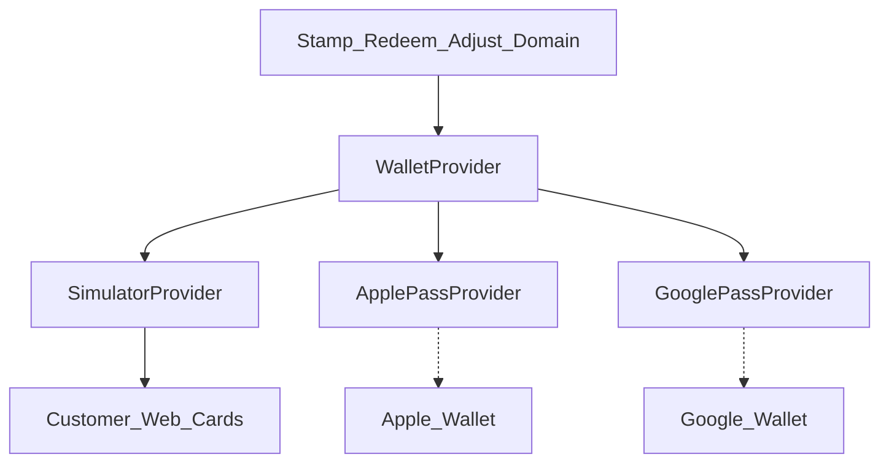
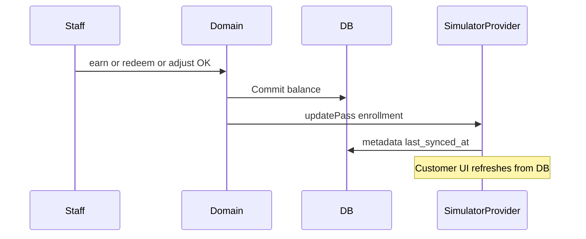

# Smart Loyalty – Wallet Integration

**Document:** 06_Wallet_Integration  
**Phase:** 0 (Documentation – refined)  
**Status:** Draft for approval  
**Last updated:** 2026-11-01 (verified integrity pass)

---

## 1. Purpose

Define Wallet Simulator (MVP first target) and clear separation from Apple Wallet and Google Wallet. Do not invent vendor API capabilities. Do **not** simulate successful Apple or Google installation.

---

## 2. Requirements mapping

| Need | MVP | Later |
|------|-----|-------|
| Dynamic stamp updates | Simulator after earn / redeem (ledger REDEEM) / adjust | Vendor update flows per official docs |
| Customer-specific QR | Simulator card QR (hashed secret at rest) | Same token strategy in real passes |
| Business branding | Theme / logo from business + program | Pass field mapping |
| Current stamp balance | Shown after every committed change | Vendor object fields |
| Reward status | Available when balance ≥ threshold; updates after each redemption | Vendor fields |
| Multiple business cards | One Simulator card per enrollment | One pass per enrollment per platform |
| Independence from Apple/Google | **Required** | Paid credentials when approved |

Reward status must reflect **subtract-and-preserve** math: after redeeming 10 from 12, show balance 2 and availability based on whether 2 ≥ threshold.

---

## 3. Adapter separation

| Provider | Enabled when | May claim install success |
|----------|--------------|---------------------------|
| `SIMULATOR` | Always for MVP | Yes — card ready in Smart Loyalty |
| `APPLE` | Feature flag + real certs | Only after real PassKit issue |
| `GOOGLE` | Feature flag + real issuer | Only after real save/issue |

**Hard rule:** Never show “Added to Apple Wallet” / “Saved to Google Wallet” without a real vendor response.

---

## 4. Wallet Simulator (first implementation target)

### 4.1 Capabilities

- Web UI card per `customer_programs` enrollment.  
- Business branding.  
- Live shared **stamp balance**.  
- **Reward status** (progress / available).  
- Customer-specific QR for staff scan.  
- Dynamic update after server-confirmed earn, redeem, or adjust.  
- Customer account lists **multiple** business cards.  
- Updates must follow domain results for **EARN / REDEEM / ADJUST / REVERSAL** idempotency (`ON CONFLICT DO NOTHING` + `request_hash` compare; UI uses server-returned balance).  
- **`INSUFFICIENT_BALANCE` on redeem:** do **not** update wallet metadata (full DB rollback; no redeem side effects).  
- No MVP UI for cancelling a completed redemption (**TBD**); redemption status is `COMPLETED` only.

### 4.2 Persistence

- `wallet_passes.platform = SIMULATOR`.  
- `metadata_json`: non-secret snapshot (`balance`, `stampsRequired`, `rewardAvailable`, brand refs).  
- Never store raw QR secrets in metadata.

### 4.3 What it is not

- Not PassKit / Google Wallet.  
- Not a fake vendor install success.  
- Not dependent on paid developer accounts.

---

## 5. Apple Wallet (deferred)

Only with approval and Apple Developer Program. Follow current PassKit docs. Schema reserved. UI may show “Coming soon”.

---

## 6. Google Wallet (deferred)

Only with approval and issuer access. Follow current Google Wallet API docs. Schema reserved. No fake save success.

---

## 7. Dynamic update sequence (Simulator)

Domain commits (including idempotent no-ops that return prior state) before UI relies on balance.

---

## 8. QR and multi-card account

- Each enrollment has its own QR secret (see `03_Database_Design.md`).  
- Staff validation scoped to staff `business_id`.  
- Customer account shows all Simulator cards.

---

## 9. Risks

| Risk | Mitigation |
|------|------------|
| Confusing Simulator with Apple/Google | Explicit labeling; separate providers |
| Blocking MVP on paid wallets | Simulator-first |
| Secret leakage in metadata | No raw QR secret in JSON |
| Stale UI after idempotent replay | Prefer server-returned balance |

---

## 10. Related documents

- `01_PRD.md`  
- `03_Database_Design.md`  
- `05_User_Flows.md`  
- `07_Security_and_GDPR.md`  
- `10_Free_Infrastructure_and_Costs.md`  
