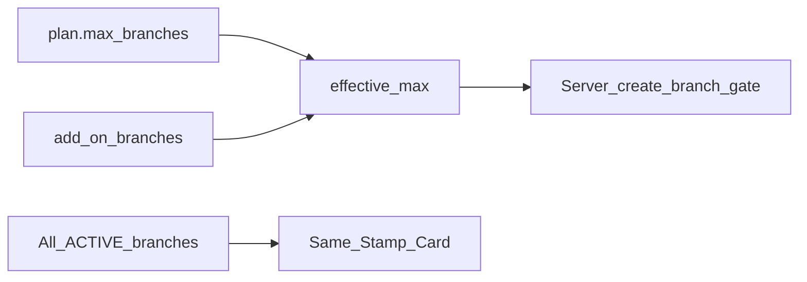

# Smart Loyalty – Subscription and Pricing

**Document:** 08_Subscription_and_Pricing  
**Phase:** 0 (Documentation – refined)  
**Status:** Draft for approval  
**Last updated:** 2026-11-01 (verified integrity pass)

---

## 1. Purpose

Commercial subscription model: each business buys its own plan, included branches, add-on branches, and server-side enforcement. Stripe is prepared but **not required** for MVP live payments.

**Prices and final packages remain placeholders.** Do not treat figures in this document as finalized commercial pricing.

---

## 2. Business model (confirmed)

- B2B SaaS: **each business purchases its own subscription**.  
- Customers use the product free.  
- Plans include a **defined number of branches** (draft quotas only).  
- Businesses may **purchase additional branches**.  
- **All branches share the same Stamp Card**.  
- Limits checked **server-side**; clients cannot bypass.  
- MVP: enforce limits in software; billing UI may say payments coming soon; Platform Admin may adjust pilots manually.  
- Stripe schema fields reserved; **MVP must not require live payments**.

---

## 3. Plan catalog (placeholders)

| Code | Name | Segment |
|------|------|---------|
| `starter` | Starter | Smallest / single-location |
| `professional` | Professional | More staff / early multi-branch |
| `business` | Business | Multi-branch operators |
| `enterprise` | Enterprise | Custom |

### 3.1 Draft quotas (not commercial final)

| Limit | Starter | Professional | Business | Enterprise |
|-------|---------|--------------|----------|------------|
| Included branches | 1 | 2 | 5 | Custom |
| Add-on branches allowed | Yes | Yes | Yes | Yes |
| Max employees | 3 | 10 | 50 | Custom |
| Max ACTIVE Stamp Cards (MVP product) | 1 | 1 | 1 | Custom later |
| Max customers | Fair use | Fair use | Fair use | Custom |
| Wallet Simulator | Yes | Yes | Yes | Yes |
| Apple / Google Wallet | Flag later | Flag later | Flag later | When enabled |

### 3.2 Placeholder monthly prices (EUR display only)

| Item | Placeholder |
|------|-------------|
| Starter | €19 |
| Professional | €49 |
| Business | €99 |
| Enterprise | Contact |
| Add-on branch | €10 / branch / month |

**These are illustrative only and are not finalized.**

---

## 4. Branch limits and shared loyalty

- `effective_max_branches = plan.max_branches + subscription.add_on_branches`.  
- Create branch when ACTIVE count would exceed effective max → **hard reject**.  
- Only **ACTIVE** branches count toward capacity.  
- Inactivated/archived branches retain history but do not consume capacity (reactivation re-checks limit).  
- New ACTIVE branches participate in the same Stamp Card; balances remain global across branches.

---

## 5. Subscription states

| Status | Behavior |
|--------|----------|
| `TRIALING` | Features of trial plan |
| `ACTIVE` | Full features |
| `PAST_DUE` | **Grace period confirmed**; then restrictions apply. **Exact grace duration TBD. Exact post-grace restriction set TBD.** |
| `CANCELLED` | Read-only after period end (**details TBD** if needed) |
| `EXPIRED` | Block stamps, redeems, mutating ops (**baseline intent**) |

Schema supports `past_due_since` and `grace_period_ends_at` without fixing the duration in documentation.

---

## 6. Server-side enforcement points

| Action | Who | Check |
|--------|-----|-------|
| Create branch | Owner, Manager | ACTIVE count < effective max |
| Invite employee | Owner, Manager | ACTIVE members ≤ max_employees |
| Ensure ACTIVE program | Owner, Manager | MVP: only one ACTIVE |
| Customer join | Customer | Optional max_customers |
| Stamp / redeem / adjust | Staff (role-appropriate; ADJUST ≠ Employee) | Business not SUSPENDED/CLOSED; subscription gate includes PAST_DUE grace **TBD**; loyalty mutations remain idempotent |
| Change plan / buy add-ons | **Owner only** | Stripe later; manual admin now |

Employees have **no** billing access.

---

## 7. Stripe (future preparation)

Follow official Stripe Billing documentation when approved. Nullable Stripe columns exist now; MVP does not require live payments.

---

## 8. Platform admin

Maintain plan catalog (placeholder prices); manually set plan / add-ons / status for pilots; view distribution.

---

## 9. Unresolved commercial decisions

1. Trial length.  
2. Starter free-forever vs paid.  
3. **Final** quotas and prices (placeholders until then).  
4. PAST_DUE **grace duration**.  
5. PAST_DUE **restriction policy** after grace (which writes/reads blocked).  
6. Annual discount.  
7. Whether Managers see read-only usage meters (still no purchase).

---

## 10. Related documents

- `03_Database_Design.md`  
- `04_User_Roles_and_Permissions.md`  
- `05_User_Flows.md`  
- `09_Development_Roadmap.md`  
- `10_Free_Infrastructure_and_Costs.md`  
