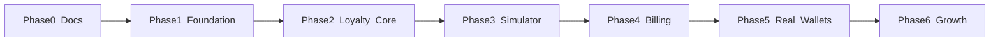

# Smart Loyalty – Development Roadmap

**Document:** 09_Development_Roadmap  
**Phase:** 0 (Documentation – refined)  
**Status:** Draft for approval  
**Last updated:** 2026-11-01 (verified integrity pass)

---

## 1. Purpose

Sequence delivery from documentation through production SaaS, respecting free-development constraints, Simulator-first wallets, and deferred live billing.

**Phase 1 must not begin without explicit approval.**

---

## 2. Phase overview

| Phase | Name | Primary outcome |
|-------|------|-----------------|
| 0 | Documentation | `/docs` approved |
| 1 | Foundation | Scaffold, schema, auth, tenancy, shells, RLS companion, pooling |
| 2 | Loyalty core | Join, idempotent earn/redeem, adjustments, global balance, limits |
| 3 | Simulator polish | Multi-card UI, dynamic updates, join QR, basic analytics |
| 4 | Billing | Stripe with approval; add-on branches; PAST_DUE automation |
| 5 | Real wallets | Apple + Google behind flags |
| 6 | Growth | Geofencing, notifications, marketing |

---

## 3. Phase 0 – Documentation

**In scope:** All ten docs; confirmed business decisions incorporated; consistency review.

**Out of scope:** Application code, dependency installs, migrations, Phase 1 start.

---

## 4. Phase 1 – Foundation

1. Align repo root (fate of accidental `smart-loyalty/` scaffold — **TBD**).  
2. Next.js + TypeScript + Tailwind; GitHub.  
3. Prisma schema per `03_Database_Design.md` (composite FKs, idempotency uniques, archive fields).  
4. Supabase Free EU; Prisma **pooled** URL.  
5. Auth SSR: Email+Password and Magic Link/OTP.  
6. Middleware + membership/Owner billing gates.  
7. Business registration; dashboard/staff/admin shells.  
8. RLS SQL companion.  
9. ENV/SETUP docs; lint, typecheck, build; isolation tests.

**Exit:** Owner sees only own business; cross-tenant reads fail in tests.

---

## 5. Phase 2 – Loyalty core

1. `/join/[slug]` mobile-first; enroll shared-balance card.  
2. Branches/employees/assignments (Employee default `SELECTED_BRANCHES`).  
3. Staff QR lookup; **idempotent** EARN/REDEEM/ADJUST/REVERSAL (replay vs conflict).  
4. Redeem as ledger type `REDEEM` (not ADJUST); subtract required stamps; multiple redemptions when balance allows.  
5. Subscription usage UI without live Stripe; PAST_DUE fields present (policy TBD).

**Exit:** Multi-branch shared balance; redeem remainder preserved; duplicate keys do not double-apply (incl. concurrent unique-violation path); REDEEM/redemption field match tests pass; second business join works; no cancel-redemption API.

---

## 6. Phase 3 – Wallet Simulator

Simulator provider, multi-card account, branding, dynamic updates, business join QR, basic analytics.

---

## 7. Phase 4 – Billing (Stripe)

Official Stripe Billing; webhooks; add-ons; implement PAST_DUE grace **once duration/policy approved**.

---

## 8. Phase 5 – Apple & Google Wallet

Feature flags; real providers only; no fake success. Requires paid accounts + approval.

---

## 9. Phase 6 – Growth

Geofencing, location notifications, marketing automation, advanced analytics, job infrastructure.

---

## 10. Testing strategy

| Layer | Focus |
|-------|-------|
| Unit | Limit math; QR hash; redeem subtract; insufficient-balance rollback; idempotency replay vs conflict |
| Integration | Composite isolation; typed REDEEM FK; matching REDEEM/redemption fields; `INSUFFICIENT_BALANCE` leaves zero rows; concurrent same-key races; branch scope; ADJUST/REVERSAL authz; single-reversal constraint |
| E2E (later) | Join → multi-branch earn → multi-redeem |
| Manual | Mobile staff + customer join |

---

## 11. Decisions confirmed

| Decision | Resolution |
|----------|------------|
| Product MVP | Digital Stamp Card only |
| Programs | One ACTIVE Stamp Card per business; schema allows more later |
| Branch loyalty | Shared balance; txn/redemption store branch |
| Customer identity | One central account; many enrollments |
| Self-stamping | Forbidden |
| Redeem math | Subtract required stamps; preserve remainder |
| Multiple rewards | Allowed if balance permits; each redemption separate |
| Idempotency | Required for EARN, REDEEM, ADJUST, REVERSAL; `INSERT … ON CONFLICT DO NOTHING` + `request_hash` compare |
| Ledger types | EARN / REDEEM / ADJUST / REVERSAL; `reward_id` NOT NULL only on REDEEM |
| Redemption FK | Typed composite FK to ledger `REDEEM`; matched fields; MVP status `COMPLETED` only |
| REVERSAL | Column `reversal_of_transaction_id`; composite FK same business+enrollment; once; full vs partial **TBD** (not approved) |
| Cancel redemption | Not in MVP; no `CANCELLED` enum value; policy **TBD** |
| Branch defaults | Employee `SELECTED_BRANCHES`; Owner/Manager `ALL_BRANCHES`; may grant employee ALL |
| Manual adjustments | Owner/Manager only; reason + member + branch recorded |
| Billing access | Owner only |
| Employee PII | Minimized on scan |
| Wallets MVP | Simulator first; no fake Apple/Google success |
| Subscription | Per-business; add-on branches; server-side limits |
| PAST_DUE | Grace period **exists**; duration and restriction set **TBD** |
| Pricing | Placeholders only; not finalized this phase |
| Stripe live | Not required for MVP |
| Paid APIs | Explicit approval required |
| Free vs commercial | Free for dev/test aim; commercial not promised at €0 |
| Hosting | Vercel only if current terms allow intended usage |
| DB | Supabase Free for initial dev; EU preferred (Frankfurt if available) |
| ORM | Prisma with connection pooling |
| SCM | GitHub |
| Tenant key | `business_id` only; composite FKs |
| QR secrets | CSPRNG; hash at rest; no plaintext secret column |
| GDPR roles | Controller/processor = unresolved legal decision |

---

## 12. Decisions still open (TBD)

1. Trial length; Starter free-forever vs paid.  
2. **Final** commercial prices and package quotas.  
3. PAST_DUE **grace duration**.  
4. PAST_DUE **restriction policy** after grace (and behavior during grace).  
5. Rate-limit numeric defaults.  
6. Retention / erasure details with counsel.  
7. Production host if Vercel Hobby unsuitable.  
8. Confirm Frankfurt on chosen Supabase free project.  
9. Owner transfer / last-owner protection.  
10. Fate of partial `smart-loyalty/` scaffold.  
11. Manager read-only usage meters (no purchase).  
12. Timeline/budget for Apple Developer / Google issuer.  
13. Whether CANCELLED mid-period subscription read-only nuances need more product rules.  
14. REVERSAL full vs partial amounts (**TBD** — Full Reversal only has **not** been approved).  
15. Completed **reward redemption cancellation** policy (and who may cancel) — blocked in MVP; no `CANCELLED` status until decided.  
16. Idempotency key TTL / retention (**implementation detail TBD**).

---

## 13. Technical risks that still need attention

| Risk | Notes |
|------|--------|
| Prisma without pooler | Connection exhaustion on free Supabase |
| Service-role vs RLS | App authz must never be skipped |
| Idempotency key UX | Clients retry with same key + payload; server uses ON CONFLICT DO NOTHING + hash compare; key TTL **TBD** |
| Dual redeem writes | One balance update + matching REDEEM ledger + redemption detail in one txn |
| Reversal of REDEEM | Blocked/ambiguous until cancellation policy TBD |
| Concurrent earn/redeem | Require `FOR UPDATE`; test under load |
| PAST_DUE ambiguity | Cannot fully implement gates until duration/policy decided |
| Archive vs capacity | Reactivating branches must re-check limits |
| Free-tier ToS | May block commercial launch without paid host/DB |
| QR ciphertext key management | App encryption key rotation for re-display |
| Legal GDPR allocation | Blocks production DPA certainty |

---

## 14. Dependencies

| Dependency | Needed for | Blocker if missing |
|------------|------------|--------------------|
| Explicit Phase 0 / Phase 1 approval | Start coding | Yes |
| Supabase project (EU) | Auth + DB | Yes for integration |
| GitHub access | Collaboration | Recommended |
| Hosting with allowed ToS | Deployed previews | Soft for local-only |
| PAST_DUE policy decisions | Complete billing enforcement | Soft until Phase 4 |
| Stripe account | Phase 4 | No for Phases 1–3 |
| Apple / Google accounts | Phase 5 | No for MVP |
| Legal counsel | GDPR role/DPA | Soft for internal demo; hard before scale |

---

## 15. Recommended Phase 1 implementation order

1. Explicit approval to start Phase 1.  
2. Repository layout decision (`smart-loyalty/` vs root).  
3. Scaffold Next.js + TypeScript + Tailwind; GitHub.  
4. Supabase Free (EU/Frankfurt if available); pooled `DATABASE_URL`.  
5. Prisma schema + seed (multi-branch demo, one ACTIVE program, idempotency uniques).  
6. Auth helpers + middleware (password + magic link/OTP).  
7. Tenant authz + composite-aware queries.  
8. Business registration + dashboard/staff/admin shells.  
9. RLS companion SQL.  
10. `.env.example`, SETUP docs; lint, `tsc`, build, isolation tests.

Loyalty earn/redeem/idempotency land in **Phase 2** once foundation exits.

---

## 16. Phase 0 readiness

Documentation incorporates approved business decisions and is **ready for Phase 0 approval**, subject to stakeholder sign-off on this revision. Phase 1 remains blocked until **explicit** approval.

---

## 17. Related documents

- `01_PRD.md`  
- `02_System_Architecture.md`  
- `03_Database_Design.md`  
- `10_Free_Infrastructure_and_Costs.md`  
